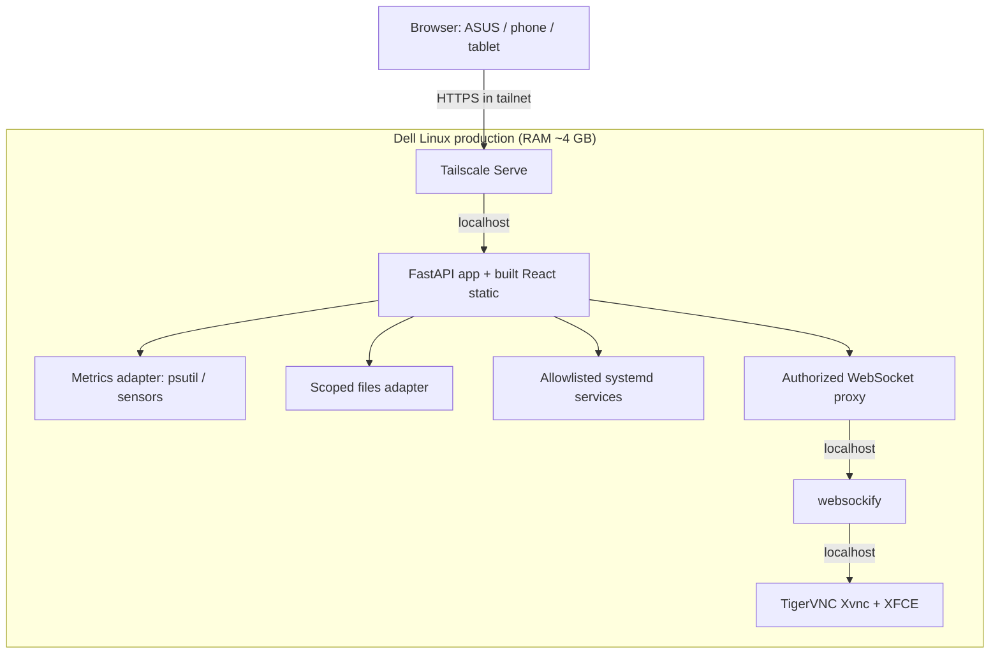
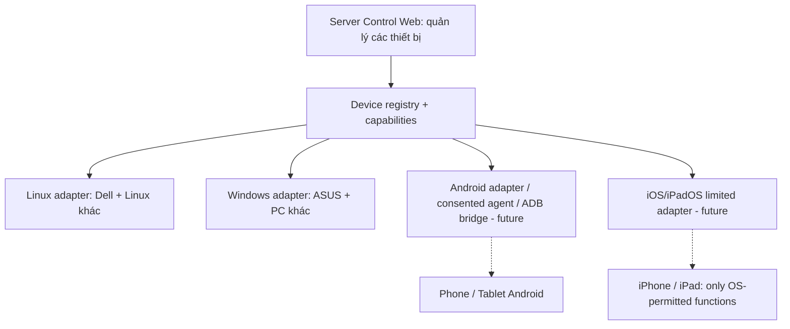
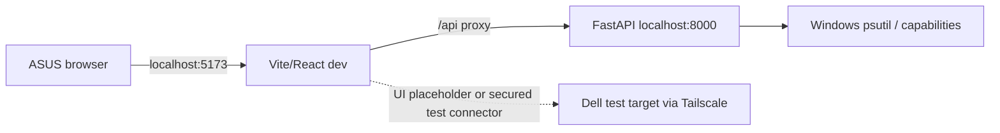

# Server Control — Architecture

> Status: DRAFT v0.2. Chiến lược: **modular monolith**, không phải nhiều server/microservice.

## 1. Kiến trúc tổng quan



**Diễn giải:** browser không kết nối thẳng VNC/SSH public. Tailscale Serve nhận HTTPS riêng trong tailnet và chuyển về app ở loopback. Frontend chỉ gọi cùng origin. Agent metrics là module nội bộ của backend, không phải dịch vụ riêng trong MVP. Hướng reverse proxy WebSocket cần được kiểm thử trên môi trường thực, tránh giả định mặc định mọi proxy route đều tương thích.

### Hướng mở rộng multi-device (sau v1, chưa triển khai)

V1 tập trung một Dell. Tuy nhiên hệ thống **không được đồng nhất "thiết bị" với "trình duyệt đang mở web"**. Trong tương lai, mobile/tablet có thể là thiết bị đích được quản lý từ ASUS hoặc từ một trình duyệt khác.



- Khóa định danh thiết bị (`device_id`) độc lập khỏi URL/IP Tailscale; có `platform`, `device_type`, `capabilities`, `last_seen`.
- `capabilities` quyết định được xem metrics, file transfer, screen view, remote input hay không. **Không thiết kế UI giả định iOS/Android có quyền điều khiển giống Dell**.
- Phần **transport** (Tailscale/SSH/USB) tách khỏi phần **control adapter** (Linux, Windows, Android, iOS) và phần **authorization/consent**.
- Chỉ chuẩn bị ranh giới module và schema có thể mở rộng; không triển khai microservices hoặc mobile agents khi đang làm v1.

## 2. Development trên ASUS



- Frontend dev dùng Vite + React + TypeScript.
- Backend dev dùng Python 3.12+ khi có trên ASUS (phiên bản Windows **chưa xác minh**), FastAPI + Uvicorn + psutil.
- `Vite proxy` cùng path `/api` để giảm CORS trong dev; không public dev server.
- Unit/API test, build, layout và simulated desktop states trên ASUS.
- **Chỉ test desktop Dell thật khi đã có Dell VNC**. Việc này là tích hợp có kiểm soát, không đồng nghĩa deploy web production sớm.
- Không lấy CPU Dell khi API trên ASUS đang đọc local Windows, trừ khi có kết nối/agent rõ ràng.

## 3. Production trên Dell

```text
Tailscale tailnet
      |
 Tailscale Serve [HTTPS]
      |
 127.0.0.1:8000   FastAPI (systemd, non-root)
      |-- /          frontend/dist static (SPA fallback)
      |-- /api/*     API + auth + metrics + files + services
      `-- /desktop-ws  authenticated WebSocket proxy
                                |
                      127.0.0.1:6080 websockify
                                |
                      127.0.0.1:5901 TigerVNC Xvnc :1
                                |
                           XFCE session
```

- Static build tạo ở ASUS, chép lên Dell cùng backend code/config.
- Backend chạy `127.0.0.1`, dưới user hạn chế, do systemd giám sát.
- Xvnc không tự bật toàn thời gian nếu không cần; XFCE được khởi chạy trong session ảo và không yêu cầu monitor vật lý.
- VNC và websockify chỉ bind loopback; kiểm tra lại bằng `ss -lntp` sau setup.
- **Lưu ý WebSocket:** nếu proxy auth/route tùy chỉnh gây phức tạp, có thể dùng một reverse proxy nhỏ đã được kiểm thử hoặc một endpoint bridge riêng. Không được mở websockify thẳng ra WAN/tailnet như cách né khó. Giải pháp cuối phải được ghi lại khi M3 hoàn thành.

## 4. Components

| Module | Trách nhiệm | Không làm |
|---|---|---|
| `frontend` | Dashboard, charts, responsive nav, VNC viewer, Files, System | Không chứa server credentials, không execute shell |
| `backend/api` | HTTP endpoints, schema validation, auth, access policy | Không đọc filesystem tùy tiện, không chạy command do browser đưa lên |
| `backend/services/metrics` | psutil + optional sensors; normalized metrics | Không lưu DB hay scan máy khác ở MVP |
| `backend/services/files` | thao tác tệp trong configured roots | Không expose `/etc`, home root hay toàn disk |
| `backend/services/system` | trạng thái dịch vụ allowlist và logs giới hạn | Không `sudo` tùy ý hoặc edit firewall |
| `backend/services/desktop` | quản lý trạng thái session VNC và websockify | Không xử lý raw video encoding từ đầu |
| `deploy/linux` | systemd, env template, healthcheck, deploy/rollback docs | Không cấu hình lại BIOS hoặc thay đổi mạng bắt buộc |

## 5. Data model (định hướng, chưa khóa schema)

```json
{
  "timestamp": "2026-10-31T10:00:00+07:00",
  "source": "local-host",
  "device": {"id": "<uuid>", "label": "Dell", "role": "production", "platform": "linux", "device_type": "computer"},
  "cpu": {"usage_percent": 12.5},
  "memory": {"used_bytes": 1000000000, "total_bytes": 3900000000},
  "disk": {"mount": "/", "used_bytes": 1000, "total_bytes": 2000},
  "network": {"rx_bytes_per_sec": 1000, "tx_bytes_per_sec": 500},
  "sensors": {"battery": {"value": null, "status": "unavailable"}},
  "uptime_seconds": 21000
}
```

Đây là schema **minh họa**, không phải sample đo thật. Phân biệt `bytes total` và `bytes/s`. Frontend có thể rolling history 10 phút in-memory. Nếu cần data lịch sử ngày/tuần mới xem xét SQLite theo một quyết định mới.

## 6. Security boundaries

1. **Network:** chỉ tailnet HTTPS qua Tailscale Serve; không router forwarding; backend và VNC bind localhost.
2. **Identity:** owner cần cơ chế xác thực đáng tin cậy trong app hoặc thông qua Tailscale identity được kiểm chứng chặt chẽ; không tin header tự gửi từ client, không tin `X-Forwarded-*` tùy tiện. Nếu dùng headers Tailscale, chỉ chấp nhận khi backend không thể bị gọi bỏ qua reverse proxy.
3. **Authorization:** metrics/read-only có thể đơn giản nhưng nên bảo vệ app; files & service actions phải xác thực, validate resource, CSRF/Origin tương ứng.
4. **Filesystem:** root allowlist, resolve realpath rồi kiểm tra containment; cấm symlink bypass. Chặn upload file quá giới hạn; sanitize file name.
5. **Process:** không gọi shell từ request. Nếu cần điều khiển vài service, dùng wrapper được kiểm soát (policykit/sudoers hẹp) và ghi audit; không cấp sudo toàn backend.
6. **Desktop:** VNC credential lưu ngoài Git; không hiển thị trên UI/log; WebSocket handshake authenticated. Session của GUI chạy với user thường.
7. **Observability:** log request failures, trạng thái services, desktop lifecycle; không ghi password/token, lọc path/PII nhạy cảm.
8. **Disaster:** lỗi BIOS/F1 không chữa bằng software. Không tuyên bố tự khởi động sau mất điện cho tới khi sửa/kiểm chứng độc lập.

## 7. Resource budget và trade-off

- Dell i5-3337U, ~3.7 GiB RAM, HDD. Ưu tiên một FastAPI process, frontend static, không phát triển build trực tiếp trên Dell.
- Polling 2s phù hợp MVP đơn máy; WebSocket dành cho desktop. Thay vì stream metrics liên tục bằng WebSocket, trước mắt REST polling dễ bảo trì.
- Nhiệt độ qua `psutil.sensors_temperatures()` có thể không khả dụng ở Windows; UI phải nhận capability.
- VNC/XFCE chiếm RAM; chỉ một session, tối ưu 1280×720; đo trước khi chọn làm service 24/7.
- Không dùng Docker bắt buộc; có thể dùng Docker sau nếu có lý do cụ thể và đo tài nguyên.
- Test thật mức độ hỗ trợ keyboard/mobile: noVNC được hỗ trợ trình duyệt hiện đại, nhưng UX thao tác terminal trên màn nhỏ không chắc tương đương PC.

## 8. Triển khai và rollback (phác thảo; viết script ở M6)

1. Build và test trên ASUS → đóng gói frontend dist, backend requirements lock.
2. Copy release lên một thư mục phiên bản trên Dell (qua SSH/SFTP/Git).
3. Cài venv cho release, đặt env/secrets ngoài repo, verify dependencies.
4. Chạy preflight localhost (`/api/health`), bảo đảm SSH/Tailscale vẫn sống.
5. Chuyển service systemd sang release mới; healthcheck; nếu lỗi rollback bản trước.
6. Dùng Tailscale Serve xuất bản port ứng dụng, kiểm tra từ ASUS + mobile.
7. Thực hiện smoke test metrics, desktop, file, logs.

Không dùng một lệnh deploy làm mất SSH/Tailscale khi chưa có kênh cứu hộ tại nhà. Không thay đổi `Wake on AC`/BIOS trong script.

## 8A. Mobile/tablet future target — security

- Việc chủ thiết bị mở web trên điện thoại **không tự cấp quyền** đọc dữ liệu hay điều khiển điện thoại đó.
- Điều khiển/stream màn hình phải có cấp phép theo thiết bị, có thể thu hồi; không hỗ trợ điều khiển bí mật hoặc vượt quyền OS.
- Nếu muốn kết nối qua ADB/scrcpy, phải kiểm thử rõ USB hay IP, trạng thái authorization/debugging, quyền và độ ổn định; không giả định chỉ cần Tailscale là điều khiển được.
- Với iOS/iPadOS phải chấp nhận các hạn chế API/OS, tránh cam kết tính năng giống Android trước khi có bằng chứng.

## 9. Decision log

| ADR | Quyết định | Lý do |
|---|---|---|
| ADR-001 | Code/build trên ASUS, production trên Dell | Dell yếu; dev thuận tiện; máy chính không cần bật 24/7 |
| ADR-002 | React + TS + Vite / FastAPI | UI tương tác tốt + Python đọc hệ thống |
| ADR-003 | Single backend, static frontend, no DB MVP | Giảm RAM và số tiến trình |
| ADR-004 | Virtual XFCE + TigerVNC + noVNC | GUI trong browser, terminal trong desktop, không cần full VM |
| ADR-005 | Không có web CLI page | Người dùng đã loại bỏ tính năng trùng lặp |
| ADR-006 | Tailscale Serve, không Funnel | Truy cập private, không công khai lên WAN |
| ADR-007 | Giám sát read-only trước điều khiển | An toàn khi server có sự cố CMOS/F1 |
| ADR-008 | Desktop on-demand | Tiết kiệm RAM 4 GB |

## 10. Official references

- Tailscale Serve: https://tailscale.com/docs/features/tailscale-serve
- Tailscale Serve CLI: https://tailscale.com/docs/reference/tailscale-cli/serve
- noVNC: https://novnc.com/
- TigerVNC Xvnc: https://tigervnc.org/doc/Xvnc.html
